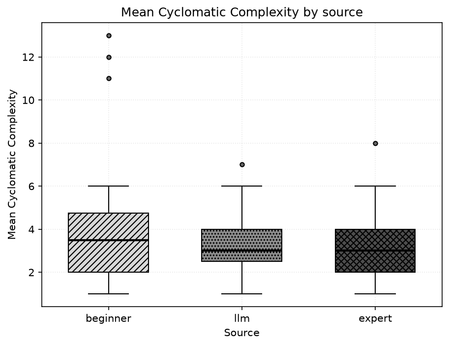
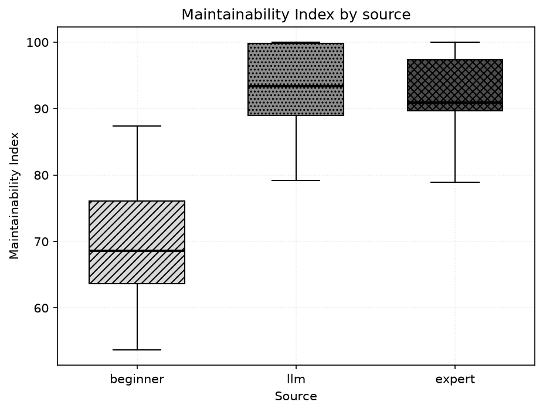
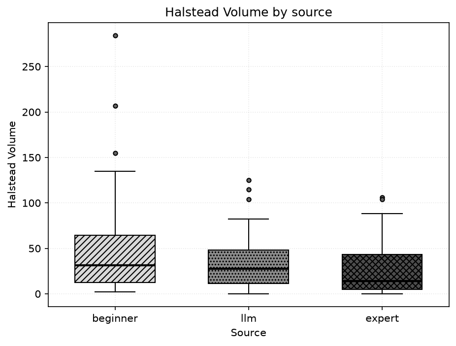
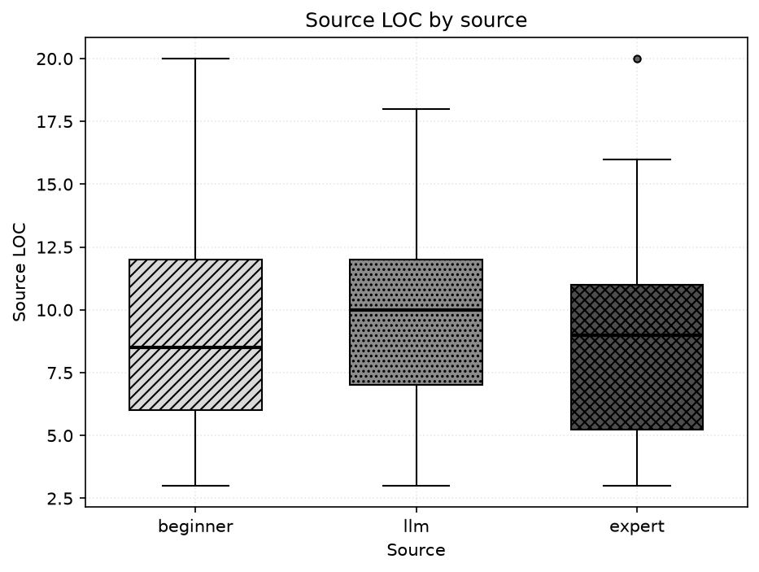
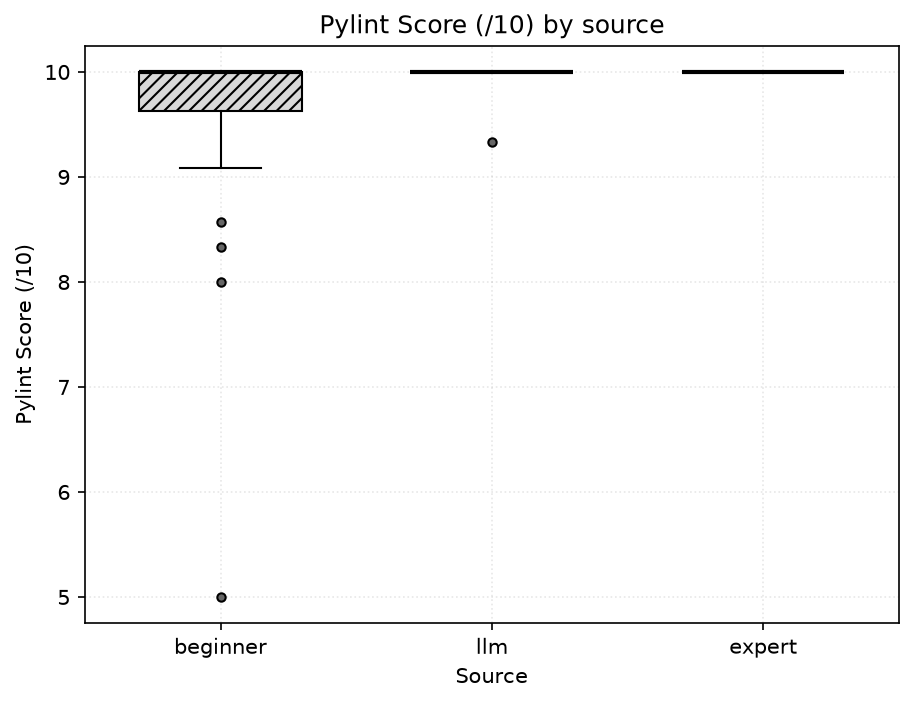
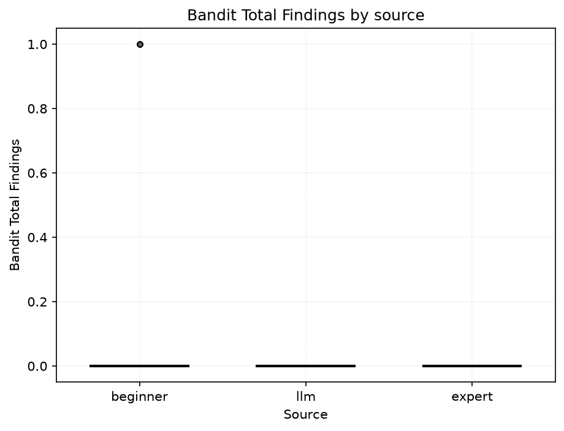
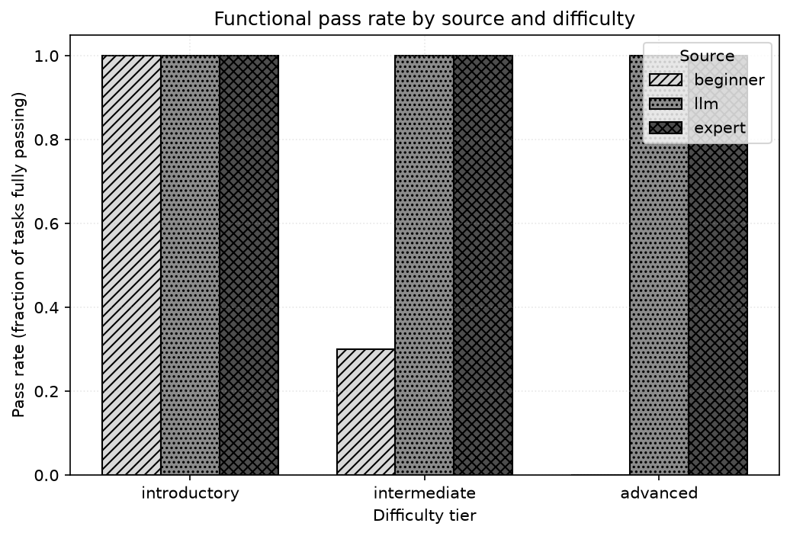
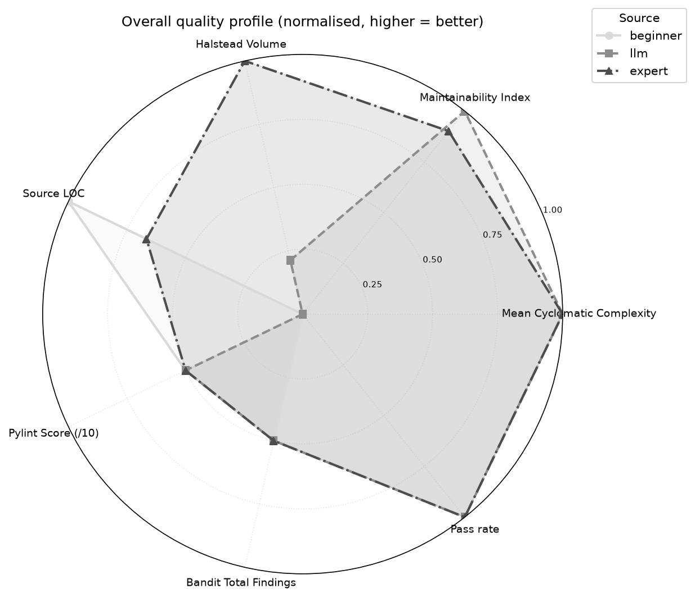

# Tharun Project — Automated Comparative Analysis of Code Generated by a Beginner, an LLM, and an Expert

**Author:** Tharun  
**Institution:** University of Roehampton  
**Date:** 2026-10-16

_This report is generated automatically by `run_analysis.py`. Every figure, table and statistic below is read directly from `outputs/metrics.csv` and `outputs/stats.json`; no value is entered by hand. Where a value could not be computed it is shown as `N/A`._

---

## 1. Executive Summary

This study compares Python solutions from three sources — **beginner**, **LLM**, and **expert** — across **30** benchmark tasks, using static-analysis metrics, functional testing and non-parametric statistics. Headline findings, all computed from the data:

- **Mean Cyclomatic Complexity** — best (lowest median) was **llm** at 3.000.
- **Maintainability Index** — best (highest median) was **llm** at 93.385.
- **Halstead Volume** — best (lowest median) was **expert** at 13.932.
- **Source LOC** — best (lowest median) was **beginner** at 8.500.
- **Pylint Score (/10)** — best (highest median) was **beginner** at 10.000.
- **Bandit Total Findings** — best (lowest median) was **beginner** at 0.000.

**Overall visible-test pass rate:** beginner 43.3%, llm 100.0%, expert 100.0%. A paired task-level Cochran Q test using LLM sample 1 gives: differences in pass rate across sources are statistically significant (Cochran Q p=4e-08). These results are not independently unseen-test estimates.

## 2. Introduction & Background

Large Language Model (LLM) coding assistants now sit between two long-standing reference points in software engineering: the novice programmer who is still acquiring idiom and rigour, and the experienced expert who writes concise, maintainable, secure code. Most published comparisons are binary — human versus AI — which collapses the very real gap between a beginner and an expert into a single 'human' category.

This project takes a three-way view. It asks not only whether LLM output differs from human output, but *where on the novice-to-expert spectrum it sits*. To do that objectively it applies the same automated pipeline of complexity, maintainability, style and security metrics to every solution, then tests each one for functional correctness and compares the groups statistically.

## 3. Dataset & Methodology

### 3.1 Benchmark dataset

The benchmark comprises **30 self-contained, pure-function programming tasks** (no I/O, no external dependencies) spread across three difficulty tiers:

| Difficulty tier | Number of tasks |
| --- | --- |
| introductory | 10 |
| intermediate | 10 |
| advanced | 10 |
| **Total** | 30 |

**Honest framing — please read.** This is a *curated, representative benchmark*. For each task the **beginner** and **expert** solutions are single authored reference implementations chosen to embody the characteristics typically associated with each source: a beginner style (works on the common cases but with poor naming, little decomposition, higher complexity, weak edge-case handling, and occasional sloppy or insecure patterns) and an expert style (idiomatic, decomposed, fully type-hinted, documented, low-complexity, edge-complete). The **LLM** solutions are labelled as model-generated in the archived dataset, sampled 5 times per task under controlled prompting; the author-reported model name, version, date and prompt are recorded in `dataset/LLM_PROVENANCE.md`. None of the code was scraped from real students, real assistants, or real professionals.

Results therefore characterise **this benchmark only** and must not be generalised to any wider population, to real beginner or expert programmers, or to other programming languages. It is intended — and deliberately left unchanged — that the beginner solutions fail some edge-case tests on the harder tasks. That monotonic decline is the experimental signal: it demonstrates that the automated pipeline can *detect* such quality and correctness differences. It is **not** an empirical finding that real beginner programmers fail at these rates.

### 3.2 Tools and metrics

Static metrics are extracted by invoking each tool's documented JSON/command-line interface (never an unverified Python API):

- **radon** — cyclomatic complexity (McCabe), maintainability index, raw size (LOC/LLOC/SLOC/comments) and Halstead volume.
- **pylint** — style/standards score (out of 10) and issue count.
- **bandit** — security findings by severity (low / medium / high).
- **pytest** — functional correctness: each solution is run in a separate process against the task's core and edge tests.

### 3.3 Statistical methods

Because samples are small and not assumed normal, analysis is non-parametric. For each numeric metric we report Shapiro-Wilk per group (normality diagnostic), a Friedman omnibus test across the three sources, paired Wilcoxon tests with within-metric Bonferroni correction (factor 3), and rank-biserial as a distribution-free effect size. Functional correctness (binary) is summarised by pass rate; matched inference uses Cochran Q on the preselected LLM sample 1 per task plus exact paired McNemar tests. Functional correctness also uses the unbiased `pass@k` estimator of Chen et al. (2021): the LLM arm is sampled 5 times per task so its `pass@k` (k>1) is a descriptive visible-test multi-sample estimate, while the single-sample beginner and expert arms report `pass@1`.

For the static-metric tests, each source contributes **one observation per task** — its per-task median across samples — so the multi-sampled LLM arm is weighted equally with the single-sample human arms rather than 5-fold. The per-sample data feed only the `pass@k` estimator and the per-sample pass rate; the full per-sample table is retained in the appendix.

## 4. Results

_Scope: the results below characterise **this benchmark only** and do not generalise to wider populations of programmers or to other programming languages._

Median value of each metric per source (computed from `outputs/metrics.csv`):

| Metric | median (beginner) | median (llm) | median (expert) |
| --- | --- | --- | --- |
| Mean Cyclomatic Complexity | 3.500 | 3.000 | 3.000 |
| Max Cyclomatic Complexity | 3.500 | 3.000 | 3.000 |
| Maintainability Index | 68.636 | 93.385 | 90.937 |
| Halstead Volume | 31.500 | 27.764 | 13.932 |
| Lines of Code (LOC) | 8.500 | 17.500 | 23.500 |
| Source LOC | 8.500 | 10.000 | 9.000 |
| Comment Lines | 0.000 | 0.000 | 0.000 |
| Pylint Score (/10) | 10.000 | 10.000 | 10.000 |
| Pylint Issue Count | 0.000 | 0.000 | 0.000 |
| Bandit Total Findings | 0.000 | 0.000 | 0.000 |

### 4.1 Figures

*Figure: Distribution of mean cyclomatic complexity per source (lower is better).*

*Figure: Distribution of maintainability index per source (higher is better).*

*Figure: Distribution of Halstead volume per source (lower is better).*

*Figure: Distribution of source lines of code per source (lower is leaner).*

*Figure: Distribution of pylint score per source (higher is better).*

*Figure: Distribution of total bandit security findings per source (lower is better).*

*Figure: Functional pass rate by source and difficulty tier.*

*Figure: Overall normalised quality profile (every axis oriented so that further out = better).*

## 5. Statistical Analysis

### 5.1 Omnibus tests (Friedman)

Matched-task group medians and the Friedman omnibus test for every metric. A significant result means at least one source differs.

| Metric | median (beginner) | median (llm) | median (expert) | Friedman chi2 | Friedman p | significant |
| --- | --- | --- | --- | --- | --- | --- |
| Mean Cyclomatic Complexity | 3.500 | 3.000 | 3.000 | 5.128 | 0.0770 | no |
| Max Cyclomatic Complexity | 3.500 | 3.000 | 3.000 | 6.432 | 0.0401 | yes |
| Maintainability Index | 68.636 | 93.385 | 90.937 | 43.655 | 3.31e-10 | yes |
| Halstead Volume | 31.500 | 27.764 | 13.932 | 14.126 | 0.000856 | yes |
| Lines of Code (LOC) | 8.500 | 17.500 | 23.500 | 55.580 | 8.53e-13 | yes |
| Logical LOC | 8.500 | 12.000 | 11.000 | 2.673 | 0.2628 | no |
| Source LOC | 8.500 | 10.000 | 9.000 | 4.784 | 0.0914 | no |
| Comment Lines | 0.000 | 0.000 | 0.000 | 2.000 | 0.3679 | no |
| Pylint Score (/10) | 10.000 | 10.000 | 10.000 | 12.667 | 0.0018 | yes |
| Pylint Issue Count | 0.000 | 0.000 | 0.000 | 12.667 | 0.0018 | yes |
| Bandit Low-severity | 0.000 | 0.000 | 0.000 | 8.000 | 0.0183 | yes |
| Bandit Medium-severity | 0.000 | 0.000 | 0.000 | N/A | N/A | N/A |
| Bandit High-severity | 0.000 | 0.000 | 0.000 | N/A | N/A | N/A |
| Bandit Total Findings | 0.000 | 0.000 | 0.000 | 8.000 | 0.0183 | yes |
| Tests Passed | 5.000 | 7.000 | 7.000 | 34.000 | 4.14e-08 | yes |

### 5.2 Pairwise comparisons (paired Wilcoxon, Bonferroni) with effect size

Pairwise tests with Bonferroni-adjusted p-values and rank-biserial effect sizes. 'sig' = adjusted p < 0.05.

| Metric | Pair | W | p (adj) | sig | Rank-biserial | paired effect |
| --- | --- | --- | --- | --- | --- | --- |
| Mean Cyclomatic Complexity | beginner vs expert | 111.000 | 0.2866 | no | 0.368 | paired |
| Mean Cyclomatic Complexity | beginner vs llm | 77.000 | 0.2921 | no | 0.391 | paired |
| Mean Cyclomatic Complexity | expert vs llm | 71.500 | 0.9766 | no | -0.247 | paired |
| Max Cyclomatic Complexity | beginner vs expert | 113.500 | 0.3262 | no | 0.353 | paired |
| Max Cyclomatic Complexity | beginner vs llm | 94.500 | 1.0000 | no | 0.182 | paired |
| Max Cyclomatic Complexity | expert vs llm | 27.000 | 0.1383 | no | -0.550 | paired |
| Maintainability Index | beginner vs expert | 2.000 | 1.68e-08 | yes | -0.991 | paired |
| Maintainability Index | beginner vs llm | 0.000 | 5.2e-06 | yes | -1.000 | paired |
| Maintainability Index | expert vs llm | 134.000 | 0.8756 | no | -0.236 | paired |
| Halstead Volume | beginner vs expert | 122.500 | 0.1197 | no | 0.437 | paired |
| Halstead Volume | beginner vs llm | 131.000 | 0.4904 | no | 0.307 | paired |
| Halstead Volume | expert vs llm | 53.000 | 0.0096 | yes | -0.674 | paired |
| Lines of Code (LOC) | beginner vs expert | 0.000 | 5.1e-06 | yes | -1.000 | paired |
| Lines of Code (LOC) | beginner vs llm | 1.500 | 5.91e-06 | yes | -0.994 | paired |
| Lines of Code (LOC) | expert vs llm | 1.500 | 8.48e-06 | yes | 0.993 | paired |
| Logical LOC | beginner vs expert | 126.000 | 0.2325 | no | -0.379 | paired |
| Logical LOC | beginner vs llm | 99.000 | 0.0524 | no | -0.512 | paired |
| Logical LOC | expert vs llm | 173.000 | 1.0000 | no | -0.085 | paired |
| Source LOC | beginner vs expert | 103.000 | 1.0000 | no | 0.186 | paired |
| Source LOC | beginner vs llm | 179.500 | 1.0000 | no | -0.116 | paired |
| Source LOC | expert vs llm | 75.000 | 0.0899 | no | -0.500 | paired |
| Comment Lines | beginner vs expert | 0.000 | 0.9519 | no | -1.000 | paired |
| Comment Lines | beginner vs llm | 0.000 | 0.9519 | no | -1.000 | paired |
| Comment Lines | expert vs llm | 0.000 | 1.0000 | no | 0.000 | paired |
| Pylint Score (/10) | beginner vs expert | 0.000 | 0.0348 | yes | -1.000 | paired |
| Pylint Score (/10) | beginner vs llm | 2.000 | 0.0452 | yes | -0.911 | paired |
| Pylint Score (/10) | expert vs llm | 0.000 | 0.9519 | no | 1.000 | paired |
| Pylint Issue Count | beginner vs expert | 0.000 | 0.0252 | yes | 1.000 | paired |
| Pylint Issue Count | beginner vs llm | 4.000 | 0.0630 | no | 0.822 | paired |
| Pylint Issue Count | expert vs llm | 0.000 | 0.9519 | no | -1.000 | paired |
| Bandit Low-severity | beginner vs expert | 0.000 | 0.1365 | no | 1.000 | paired |
| Bandit Low-severity | beginner vs llm | 0.000 | 0.1365 | no | 1.000 | paired |
| Bandit Low-severity | expert vs llm | 0.000 | 1.0000 | no | 0.000 | paired |
| Bandit Medium-severity | beginner vs expert | 0.000 | 1.0000 | no | 0.000 | paired |
| Bandit Medium-severity | beginner vs llm | 0.000 | 1.0000 | no | 0.000 | paired |
| Bandit Medium-severity | expert vs llm | 0.000 | 1.0000 | no | 0.000 | paired |
| Bandit High-severity | beginner vs expert | 0.000 | 1.0000 | no | 0.000 | paired |
| Bandit High-severity | beginner vs llm | 0.000 | 1.0000 | no | 0.000 | paired |
| Bandit High-severity | expert vs llm | 0.000 | 1.0000 | no | 0.000 | paired |
| Bandit Total Findings | beginner vs expert | 0.000 | 0.1365 | no | 1.000 | paired |
| Bandit Total Findings | beginner vs llm | 0.000 | 0.1365 | no | 1.000 | paired |
| Bandit Total Findings | expert vs llm | 0.000 | 1.0000 | no | 0.000 | paired |
| Tests Passed | beginner vs expert | 0.000 | 0.000771 | yes | -1.000 | paired |
| Tests Passed | beginner vs llm | 0.000 | 0.000771 | yes | -1.000 | paired |
| Tests Passed | expert vs llm | 0.000 | 1.0000 | no | 0.000 | paired |

### 5.3 Functional correctness

Cochran Q test of task-matched binary correctness across sources: Q = 34.000, dof = 2, p = 4e-08, significant = yes. Note: LLM sample 1 only; source matched by task; all-sample rates remain descriptive.

### 5.4 Functional pass@k (Chen et al. 2021)

Unbiased pass@k averaged over tasks. pass@k is only defined for k <= the number of samples, so single-sample sources show N/A beyond pass@1; the LLM arm is sampled multiple times per task, giving a descriptive multi-sample estimate rather than pass@1 (independence unverified).

| Source | Samples/task | pass@1 | pass@5 |
| --- | --- | --- | --- |
| beginner | 1 | 0.433 | N/A |
| llm | 5 | 1.000 | 1.000 |
| expert | 1 | 1.000 | N/A |

## 6. Findings by Research Question

### RQ1 — How does code quality compare (complexity, maintainability, size, style)?

- **Mean Cyclomatic Complexity** (best→worst by median): llm (3.000) > expert (3.000) > beginner (3.500). No pairwise difference reached significance after Bonferroni correction.
- **Maintainability Index** (best→worst by median): llm (93.385) > expert (90.937) > beginner (68.636). Significant pairwise differences: beginner vs expert (p_adj=1.68e-08, paired rank-biserial=-0.991, paired effect size); beginner vs llm (p_adj=5.2e-06, paired rank-biserial=-1.000, paired effect size).
- **Source LOC** (best→worst by median): beginner (8.500) > expert (9.000) > llm (10.000). No pairwise difference reached significance after Bonferroni correction.
- **Pylint Score (/10)** (best→worst by median): beginner (10.000) > llm (10.000) > expert (10.000). Significant pairwise differences: beginner vs expert (p_adj=0.0348, paired rank-biserial=-1.000, paired effect size); beginner vs llm (p_adj=0.0452, paired rank-biserial=-0.911, paired effect size).

### RQ2 — How do correctness and security compare?

- Overall pass rate — beginner: 43.3%, llm: 100.0%, expert: 100.0%.
- Introductory tier — beginner: 10/10 (100.0%), llm: 50/50 (100.0%), expert: 10/10 (100.0%).
- Intermediate tier — beginner: 3/10 (30.0%), llm: 50/50 (100.0%), expert: 10/10 (100.0%).
- Advanced tier — beginner: 0/10 (0.0%), llm: 50/50 (100.0%), expert: 10/10 (100.0%).
- Security — median total bandit findings (fewest→most): beginner (0.000), llm (0.000), expert (0.000). No pairwise security difference reached significance.
- The pass-rate difference across sources is statistically significant (Cochran Q p=4e-08).

### RQ3 — Does the LLM resemble the beginner or the expert?

- Across 10 metrics overall, the LLM's median was closer to the beginner on **1**, closer to the expert on **5**, and tied on **4**. Verdict: the LLM most resembles the **expert**.
- Introductory tier — closer to beginner on 2, to expert on 4, tied on 4 → resembles expert.
- Intermediate tier — closer to beginner on 2, to expert on 4, tied on 4 → resembles expert.
- Advanced tier — closer to beginner on 2, to expert on 4, tied on 4 → resembles expert.

### RQ4 — What are the limits of automated metrics?

- Concrete disagreement found in the data: task **second_largest** (beginner) attains a maintainability index of **87.350** and a pylint score of **10.000/10**, yet it still **fails functional tests** (4/6 passing). Static quality scores looked acceptable while the code was, in fact, wrong.
- In total 17 (source, task) solution(s) failed at least one test; static metrics alone would not have flagged the functional defects.
- Static metrics measure *form*, not *behaviour*: maintainability index, complexity and style score say nothing about whether output is correct.
- Security scanners such as bandit detect known insecure patterns, not logic errors or missing edge-case handling.
- These caveats are why this study pairs every static metric with executed functional tests rather than relying on metrics alone.

## 7. Limitations

- **Curated benchmark.** The beginner and expert solutions were authored to typify each source and the LLM solutions are archived model-labelled files without authenticated generation logs; none are sampled from real populations. Findings describe this benchmark only and do not generalise. The monotonic decline in the beginner pass rate across tiers shows that the pipeline can *detect* such differences; it is not a claim that real beginner programmers fail at these rates.
- **Sampling.** The beginner and expert arms use a single authored reference per task; the LLM arm is sampled 5 times per task, so `pass@k` (k>1) is defined for the LLM on the visible-generation tests; within-source variance is observable in its metrics, while the human arms remain single-sample. Statistical power is still bounded by the benchmark size; effect sizes are reported alongside p-values for transparency.
- **Model provenance.** The archive identifies Claude as the sole model family, but independent model-response receipts and original generation logs are absent. Its use of the visible evaluation tests during generation prevents treating the original 100% pass rate as unseen accuracy. A multi-vendor comparison that also includes a GPT-4-class model is left as future work.
- **Python only.** All tasks are Python; results may not transfer to other languages or paradigms.
- **Static-metric limits (see RQ4).** Maintainability, complexity, style and security scores capture form and known patterns, not functional correctness; this is why executed tests are included.

## 8. Conclusion

On this benchmark, the automated pipeline cleanly separates the three sources. The **llm** source led on maintainability, **llm** on (lowest) complexity, and **beginner** on style score, while overall functional pass rates were beginner 43.3%, llm 100.0%, expert 100.0%. The three-way framing makes visible where LLM output falls relative to beginner and expert code (RQ3), and the surfaced metric/correctness disagreements (RQ4) reinforce that static analysis must be paired with execution. All conclusions are drawn solely from the computed outputs and characterise this benchmark only; they do not generalise to wider populations of programmers or to other programming languages.

## 9. References

1. Chen, M. et al. (2021) Evaluating Large Language Models Trained on Code. arXiv:2107.03374. <https://arxiv.org/abs/2107.03374>
2. Chuang, Y. T. and Chang, H. Y. (2024) Analyzing novice and competent programmers' problem-solving behaviors using an automated evaluation system. Science of Computer Programming, 237, 103138. <https://doi.org/10.1016/j.scico.2024.103138>
3. Cotroneo, D., Improta, C. and Liguori, P. (2025) Human-Written vs. AI-Generated Code: A Large-Scale Study of Defects, Vulnerabilities, and Complexity. arXiv:2508.21634. <https://arxiv.org/abs/2508.21634>
4. Fan, A. X. et al. (2024) Evaluating the Quality of Code Comments Generated by LLMs for Novice Programmers. arXiv:2409.14368. <https://arxiv.org/abs/2409.14368>
5. Fawareh, H. J., Al-Shdaifat, H. M. and Samara, G. (2025) Comparing Open Source with Software Code Generated by AI Tools from Software Maintainability Quality Factor Perspective. WSEAS Transactions on Computer Research, 13, 653-659. <https://wseas.com/journals/cr/2025/b185118-377.pdf>
6. Hou, W. and Ji, Z. (2025) Comparing Large Language Models and Human Programmers for Generating Programming Code. Advanced Science, 12, 2412279. <https://doi.org/10.1002/advs.202412279>
7. Licorish, S. A. et al. (2025) Comparing Human and LLM Generated Code: The Jury is Still Out! arXiv:2501.16857. <https://arxiv.org/abs/2501.16857>

## Appendix

### A. Tool versions and run metadata

| Component | Version |
| --- | --- |
| Python | 3.11.9 |
| radon | 6.0.1 |
| pylint | pylint 4.1.3 |
| bandit | bandit 1.9.4 |

Run timestamp: 2026-10-16 17:20:00. Random seed: 42.

### B. Full per-task metrics

| task_id | difficulty | source | sample | mean_cc | max_cc | mi | halstead_volume | sloc | comments | pylint_score | pylint_issues | bandit_total | functional_pass | tests_passed | tests_total |
| --- | --- | --- | --- | --- | --- | --- | --- | --- | --- | --- | --- | --- | --- | --- | --- |
| count_vowels | introductory | beginner | 1 | 12.000 | 12.000 | 65.198 | 206.819 | 6 | 0 | 5.000 | 3 | 0 | True | 7 | 7 |
| count_vowels | introductory | llm | 1 | 3.000 | 3.000 | 100.000 | 15.510 | 7 | 0 | 10.000 | 0 | 0 | True | 7 | 7 |
| count_vowels | introductory | llm | 2 | 3.000 | 3.000 | 90.578 | 4.755 | 2 | 0 | 10.000 | 0 | 0 | True | 7 | 7 |
| count_vowels | introductory | llm | 3 | 2.000 | 2.000 | 100.000 | 0.000 | 4 | 0 | 10.000 | 0 | 0 | True | 7 | 7 |
| count_vowels | introductory | llm | 4 | 1.000 | 1.000 | 100.000 | 0.000 | 4 | 1 | 10.000 | 0 | 0 | True | 7 | 7 |
| count_vowels | introductory | llm | 5 | 3.000 | 3.000 | 100.000 | 15.510 | 7 | 0 | 10.000 | 0 | 0 | True | 7 | 7 |
| count_vowels | introductory | expert | 1 | 3.000 | 3.000 | 78.919 | 4.755 | 3 | 0 | 10.000 | 0 | 0 | True | 7 | 7 |
| count_words | introductory | beginner | 1 | 3.000 | 3.000 | 72.825 | 15.510 | 7 | 0 | 10.000 | 0 | 0 | True | 6 | 6 |
| count_words | introductory | llm | 1 | 1.000 | 1.000 | 100.000 | 0.000 | 2 | 0 | 10.000 | 0 | 0 | True | 6 | 6 |
| count_words | introductory | llm | 2 | 1.000 | 1.000 | 100.000 | 0.000 | 3 | 0 | 10.000 | 0 | 0 | True | 6 | 6 |
| count_words | introductory | llm | 3 | 4.000 | 4.000 | 98.366 | 11.610 | 10 | 0 | 10.000 | 0 | 0 | True | 6 | 6 |
| count_words | introductory | llm | 4 | 3.000 | 3.000 | 100.000 | 0.000 | 3 | 0 | 10.000 | 0 | 0 | True | 6 | 6 |
| count_words | introductory | llm | 5 | 3.000 | 3.000 | 97.508 | 2.000 | 3 | 0 | 10.000 | 0 | 0 | True | 6 | 6 |
| count_words | introductory | expert | 1 | 1.000 | 1.000 | 100.000 | 0.000 | 3 | 0 | 10.000 | 0 | 0 | True | 6 | 6 |
| factorial | introductory | beginner | 1 | 3.000 | 3.000 | 67.716 | 38.039 | 9 | 0 | 10.000 | 0 | 0 | True | 6 | 6 |
| factorial | introductory | llm | 1 | 3.000 | 3.000 | 99.114 | 27.000 | 7 | 0 | 10.000 | 0 | 0 | True | 6 | 6 |
| factorial | introductory | llm | 2 | 3.000 | 3.000 | 99.123 | 38.039 | 6 | 0 | 10.000 | 0 | 0 | True | 6 | 6 |
| factorial | introductory | llm | 3 | 2.000 | 2.000 | 100.000 | 13.932 | 6 | 0 | 10.000 | 0 | 0 | True | 6 | 6 |
| factorial | introductory | llm | 4 | 3.000 | 3.000 | 100.000 | 11.610 | 7 | 0 | 10.000 | 0 | 0 | True | 6 | 6 |
| factorial | introductory | llm | 5 | 3.000 | 3.000 | 95.947 | 38.039 | 9 | 0 | 10.000 | 0 | 0 | True | 6 | 6 |
| factorial | introductory | expert | 1 | 2.000 | 2.000 | 94.282 | 13.932 | 7 | 0 | 10.000 | 0 | 0 | True | 6 | 6 |
| find_max | introductory | beginner | 1 | 3.000 | 3.000 | 77.881 | 4.755 | 6 | 0 | 8.330 | 1 | 0 | True | 5 | 5 |
| find_max | introductory | llm | 1 | 2.000 | 2.000 | 79.188 | 2.000 | 6 | 0 | 10.000 | 0 | 0 | True | 5 | 5 |
| find_max | introductory | llm | 2 | 4.000 | 4.000 | 98.366 | 11.610 | 10 | 0 | 9.000 | 1 | 0 | True | 5 | 5 |
| find_max | introductory | llm | 3 | 3.000 | 3.000 | 71.325 | 11.610 | 7 | 0 | 10.000 | 0 | 0 | True | 5 | 5 |
| find_max | introductory | llm | 4 | 2.000 | 2.000 | 100.000 | 8.000 | 7 | 0 | 10.000 | 0 | 0 | True | 5 | 5 |
| find_max | introductory | llm | 5 | 2.500 | 3.000 | 62.398 | 38.054 | 13 | 0 | 10.000 | 0 | 0 | True | 5 | 5 |
| find_max | introductory | expert | 1 | 2.000 | 2.000 | 97.832 | 2.000 | 6 | 0 | 10.000 | 0 | 0 | True | 5 | 5 |
| fizzbuzz | introductory | beginner | 1 | 6.000 | 6.000 | 59.277 | 134.886 | 14 | 0 | 10.000 | 0 | 0 | True | 7 | 7 |
| fizzbuzz | introductory | llm | 1 | 5.000 | 5.000 | 89.020 | 77.709 | 13 | 0 | 10.000 | 0 | 0 | True | 7 | 7 |
| fizzbuzz | introductory | llm | 2 | 3.000 | 4.000 | 95.179 | 84.000 | 6 | 0 | 10.000 | 0 | 0 | True | 7 | 7 |
| fizzbuzz | introductory | llm | 3 | 5.000 | 5.000 | 94.673 | 28.529 | 8 | 0 | 10.000 | 0 | 0 | True | 7 | 7 |
| fizzbuzz | introductory | llm | 4 | 7.000 | 7.000 | 58.274 | 82.045 | 17 | 0 | 10.000 | 0 | 0 | True | 7 | 7 |
| fizzbuzz | introductory | llm | 5 | 3.500 | 6.000 | 85.661 | 120.000 | 13 | 0 | 10.000 | 0 | 0 | True | 7 | 7 |
| fizzbuzz | introductory | expert | 1 | 3.000 | 4.000 | 90.873 | 77.709 | 11 | 0 | 10.000 | 0 | 0 | True | 7 | 7 |
| gcd | introductory | beginner | 1 | 2.000 | 2.000 | 72.021 | 13.932 | 8 | 0 | 10.000 | 0 | 0 | True | 7 | 7 |
| gcd | introductory | llm | 1 | 2.000 | 2.000 | 100.000 | 4.755 | 5 | 0 | 10.000 | 0 | 0 | True | 7 | 7 |
| gcd | introductory | llm | 2 | 2.000 | 2.000 | 100.000 | 13.932 | 5 | 0 | 10.000 | 0 | 0 | True | 7 | 7 |
| gcd | introductory | llm | 3 | 8.000 | 8.000 | 82.245 | 225.176 | 20 | 2 | 10.000 | 0 | 0 | True | 7 | 7 |
| gcd | introductory | llm | 4 | 1.000 | 1.000 | 100.000 | 0.000 | 3 | 0 | 10.000 | 0 | 0 | True | 7 | 7 |
| gcd | introductory | llm | 5 | 3.000 | 3.000 | 84.976 | 112.588 | 17 | 2 | 10.000 | 0 | 0 | True | 7 | 7 |
| gcd | introductory | expert | 1 | 2.000 | 2.000 | 91.892 | 4.755 | 6 | 0 | 10.000 | 0 | 0 | True | 7 | 7 |
| is_palindrome | introductory | beginner | 1 | 5.000 | 5.000 | 61.654 | 64.529 | 14 | 0 | 10.000 | 0 | 0 | True | 9 | 9 |
| is_palindrome | introductory | llm | 1 | 3.000 | 3.000 | 88.318 | 11.610 | 3 | 0 | 10.000 | 0 | 0 | True | 9 | 9 |
| is_palindrome | introductory | llm | 2 | 5.000 | 5.000 | 87.543 | 92.511 | 14 | 0 | 10.000 | 0 | 0 | True | 9 | 9 |
| is_palindrome | introductory | llm | 3 | 1.000 | 1.000 | 100.000 | 11.610 | 5 | 0 | 10.000 | 0 | 0 | True | 9 | 9 |
| is_palindrome | introductory | llm | 4 | 4.000 | 4.000 | 65.740 | 50.189 | 9 | 0 | 10.000 | 0 | 0 | True | 9 | 9 |
| is_palindrome | introductory | llm | 5 | 5.000 | 5.000 | 98.940 | 15.510 | 7 | 0 | 10.000 | 0 | 0 | True | 9 | 9 |
| is_palindrome | introductory | expert | 1 | 3.000 | 3.000 | 90.308 | 11.610 | 4 | 0 | 10.000 | 0 | 0 | True | 9 | 9 |
| reverse_string | introductory | beginner | 1 | 2.000 | 2.000 | 79.742 | 4.755 | 5 | 0 | 10.000 | 0 | 0 | True | 5 | 5 |
| reverse_string | introductory | llm | 1 | 1.000 | 1.000 | 80.699 | 2.000 | 2 | 0 | 10.000 | 0 | 0 | True | 5 | 5 |
| reverse_string | introductory | llm | 2 | 2.000 | 2.000 | 100.000 | 4.755 | 5 | 0 | 10.000 | 0 | 0 | True | 5 | 5 |
| reverse_string | introductory | llm | 3 | 1.000 | 1.000 | 100.000 | 0.000 | 2 | 0 | 10.000 | 0 | 0 | True | 5 | 5 |
| reverse_string | introductory | llm | 4 | 2.000 | 2.000 | 100.000 | 14.000 | 5 | 0 | 10.000 | 0 | 0 | True | 5 | 5 |
| reverse_string | introductory | llm | 5 | 1.000 | 1.000 | 93.029 | 4.755 | 3 | 0 | 10.000 | 0 | 0 | True | 5 | 5 |
| reverse_string | introductory | expert | 1 | 1.000 | 1.000 | 80.094 | 2.000 | 3 | 0 | 10.000 | 0 | 0 | True | 5 | 5 |
| sum_list | introductory | beginner | 1 | 2.000 | 2.000 | 79.742 | 4.755 | 5 | 0 | 10.000 | 0 | 0 | True | 5 | 5 |
| sum_list | introductory | llm | 1 | 1.000 | 1.000 | 100.000 | 0.000 | 4 | 0 | 10.000 | 0 | 0 | True | 5 | 5 |
| sum_list | introductory | llm | 2 | 2.000 | 2.000 | 100.000 | 4.755 | 7 | 0 | 10.000 | 0 | 0 | True | 5 | 5 |
| sum_list | introductory | llm | 3 | 1.000 | 1.000 | 100.000 | 0.000 | 6 | 0 | 10.000 | 0 | 0 | True | 5 | 5 |
| sum_list | introductory | llm | 4 | 2.000 | 2.000 | 100.000 | 11.610 | 6 | 0 | 10.000 | 0 | 0 | True | 5 | 5 |
| sum_list | introductory | llm | 5 | 4.000 | 4.000 | 100.000 | 2.000 | 9 | 0 | 10.000 | 0 | 0 | True | 5 | 5 |
| sum_list | introductory | expert | 1 | 1.000 | 1.000 | 100.000 | 0.000 | 5 | 0 | 10.000 | 0 | 0 | True | 5 | 5 |
| sum_of_digits | introductory | beginner | 1 | 2.000 | 2.000 | 70.231 | 38.039 | 7 | 0 | 10.000 | 0 | 0 | True | 6 | 6 |
| sum_of_digits | introductory | llm | 1 | 2.000 | 2.000 | 98.206 | 38.039 | 7 | 0 | 10.000 | 0 | 0 | True | 6 | 6 |
| sum_of_digits | introductory | llm | 2 | 2.000 | 2.000 | 100.000 | 0.000 | 3 | 0 | 10.000 | 0 | 0 | True | 6 | 6 |
| sum_of_digits | introductory | llm | 3 | 2.000 | 2.000 | 99.940 | 36.000 | 5 | 0 | 10.000 | 0 | 0 | True | 6 | 6 |
| sum_of_digits | introductory | llm | 4 | 1.000 | 1.000 | 79.877 | 4.755 | 3 | 0 | 10.000 | 0 | 0 | True | 6 | 6 |
| sum_of_digits | introductory | llm | 5 | 2.000 | 3.000 | 94.901 | 33.688 | 9 | 0 | 10.000 | 0 | 0 | True | 6 | 6 |
| sum_of_digits | introductory | expert | 1 | 2.000 | 2.000 | 100.000 | 0.000 | 3 | 0 | 10.000 | 0 | 0 | True | 6 | 6 |
| binary_search | intermediate | beginner | 1 | 4.000 | 4.000 | 61.283 | 96.000 | 13 | 0 | 9.170 | 1 | 0 | False | 4 | 7 |
| binary_search | intermediate | llm | 1 | 4.000 | 4.000 | 87.019 | 104.000 | 13 | 0 | 10.000 | 0 | 0 | True | 7 | 7 |
| binary_search | intermediate | llm | 2 | 2.500 | 4.000 | 86.907 | 123.190 | 13 | 0 | 8.330 | 2 | 0 | True | 7 | 7 |
| binary_search | intermediate | llm | 3 | 3.000 | 3.000 | 98.070 | 38.054 | 7 | 0 | 10.000 | 0 | 0 | True | 7 | 7 |
| binary_search | intermediate | llm | 4 | 4.000 | 4.000 | 88.053 | 74.009 | 13 | 0 | 10.000 | 0 | 0 | True | 7 | 7 |
| binary_search | intermediate | llm | 5 | 3.000 | 4.000 | 85.172 | 125.336 | 16 | 1 | 10.000 | 0 | 0 | True | 7 | 7 |
| binary_search | intermediate | expert | 1 | 4.000 | 4.000 | 88.814 | 106.274 | 13 | 0 | 10.000 | 0 | 0 | True | 7 | 7 |
| chunk_list | intermediate | beginner | 1 | 2.000 | 2.000 | 70.399 | 36.000 | 6 | 0 | 10.000 | 0 | 0 | False | 3 | 5 |
| chunk_list | intermediate | llm | 1 | 3.000 | 3.000 | 98.794 | 13.932 | 5 | 0 | 10.000 | 0 | 0 | True | 5 | 5 |
| chunk_list | intermediate | llm | 2 | 3.000 | 3.000 | 93.107 | 31.020 | 10 | 0 | 10.000 | 0 | 0 | True | 5 | 5 |
| chunk_list | intermediate | llm | 3 | 4.000 | 4.000 | 93.033 | 11.610 | 13 | 0 | 10.000 | 0 | 0 | True | 5 | 5 |
| chunk_list | intermediate | llm | 4 | 5.000 | 5.000 | 92.115 | 13.932 | 14 | 0 | 10.000 | 0 | 0 | True | 5 | 5 |
| chunk_list | intermediate | llm | 5 | 3.000 | 3.000 | 96.277 | 47.549 | 7 | 0 | 10.000 | 0 | 0 | True | 5 | 5 |
| chunk_list | intermediate | expert | 1 | 3.000 | 3.000 | 83.923 | 13.932 | 6 | 0 | 10.000 | 0 | 0 | True | 5 | 5 |
| fibonacci | intermediate | beginner | 1 | 4.000 | 4.000 | 63.249 | 64.529 | 12 | 0 | 9.170 | 1 | 0 | False | 5 | 7 |
| fibonacci | intermediate | llm | 1 | 3.000 | 3.000 | 97.935 | 15.510 | 7 | 0 | 10.000 | 0 | 0 | True | 7 | 7 |
| fibonacci | intermediate | llm | 2 | 2.000 | 2.000 | 93.249 | 49.829 | 10 | 0 | 10.000 | 0 | 0 | True | 7 | 7 |
| fibonacci | intermediate | llm | 3 | 2.500 | 3.000 | 84.979 | 144.946 | 14 | 1 | 10.000 | 0 | 0 | True | 7 | 7 |
| fibonacci | intermediate | llm | 4 | 5.000 | 5.000 | 64.110 | 46.507 | 11 | 0 | 10.000 | 0 | 0 | True | 7 | 7 |
| fibonacci | intermediate | llm | 5 | 2.333 | 3.000 | 79.244 | 263.666 | 28 | 1 | 10.000 | 0 | 0 | True | 7 | 7 |
| fibonacci | intermediate | expert | 1 | 3.000 | 3.000 | 90.923 | 15.510 | 8 | 0 | 10.000 | 0 | 0 | True | 7 | 7 |
| is_subsequence | intermediate | beginner | 1 | 3.000 | 3.000 | 79.608 | 4.755 | 5 | 0 | 10.000 | 0 | 0 | False | 5 | 6 |
| is_subsequence | intermediate | llm | 1 | 4.000 | 4.000 | 95.244 | 51.891 | 7 | 1 | 10.000 | 0 | 0 | True | 6 | 6 |
| is_subsequence | intermediate | llm | 2 | 2.000 | 2.000 | 87.987 | 4.755 | 3 | 0 | 10.000 | 0 | 0 | True | 6 | 6 |
| is_subsequence | intermediate | llm | 3 | 6.000 | 6.000 | 93.000 | 43.185 | 11 | 0 | 10.000 | 0 | 0 | True | 6 | 6 |
| is_subsequence | intermediate | llm | 4 | 2.500 | 4.000 | 93.704 | 57.059 | 10 | 0 | 10.000 | 0 | 0 | True | 6 | 6 |
| is_subsequence | intermediate | llm | 5 | 3.000 | 3.000 | 98.743 | 20.680 | 8 | 0 | 10.000 | 0 | 0 | True | 6 | 6 |
| is_subsequence | intermediate | expert | 1 | 2.000 | 2.000 | 78.994 | 4.755 | 4 | 0 | 10.000 | 0 | 0 | True | 6 | 6 |
| roman_to_int | intermediate | beginner | 1 | 2.000 | 2.000 | 76.555 | 4.755 | 6 | 0 | 10.000 | 0 | 0 | False | 3 | 7 |
| roman_to_int | intermediate | llm | 1 | 4.000 | 4.000 | 90.938 | 77.709 | 10 | 0 | 10.000 | 0 | 0 | True | 7 | 7 |
| roman_to_int | intermediate | llm | 2 | 3.000 | 3.000 | 92.239 | 23.265 | 12 | 0 | 10.000 | 0 | 0 | True | 7 | 7 |
| roman_to_int | intermediate | llm | 3 | 3.000 | 3.000 | 100.000 | 0.000 | 14 | 0 | 10.000 | 0 | 0 | True | 7 | 7 |
| roman_to_int | intermediate | llm | 4 | 3.000 | 3.000 | 58.075 | 75.284 | 20 | 0 | 10.000 | 0 | 0 | True | 7 | 7 |
| roman_to_int | intermediate | llm | 5 | 5.000 | 5.000 | 97.408 | 30.000 | 7 | 0 | 10.000 | 0 | 0 | True | 7 | 7 |
| roman_to_int | intermediate | expert | 1 | 4.000 | 4.000 | 89.902 | 77.709 | 11 | 0 | 10.000 | 0 | 0 | True | 7 | 7 |
| run_length_encode | intermediate | beginner | 1 | 4.000 | 4.000 | 58.383 | 108.000 | 17 | 0 | 10.000 | 0 | 0 | True | 7 | 7 |
| run_length_encode | intermediate | llm | 1 | 4.000 | 4.000 | 90.744 | 24.000 | 15 | 0 | 10.000 | 0 | 0 | True | 7 | 7 |
| run_length_encode | intermediate | llm | 2 | 2.000 | 2.000 | 100.000 | 0.000 | 3 | 0 | 10.000 | 0 | 0 | True | 7 | 7 |
| run_length_encode | intermediate | llm | 3 | 4.000 | 4.000 | 88.496 | 96.000 | 12 | 0 | 10.000 | 0 | 0 | True | 7 | 7 |
| run_length_encode | intermediate | llm | 4 | 3.000 | 4.000 | 89.000 | 49.829 | 12 | 0 | 10.000 | 0 | 0 | True | 7 | 7 |
| run_length_encode | intermediate | llm | 5 | 5.000 | 5.000 | 86.270 | 59.795 | 15 | 0 | 10.000 | 0 | 0 | True | 7 | 7 |
| run_length_encode | intermediate | expert | 1 | 4.000 | 4.000 | 90.559 | 24.000 | 16 | 0 | 10.000 | 0 | 0 | True | 7 | 7 |
| second_largest | intermediate | beginner | 1 | 1.000 | 1.000 | 87.350 | 2.000 | 3 | 0 | 10.000 | 0 | 0 | False | 4 | 6 |
| second_largest | intermediate | llm | 1 | 2.000 | 2.000 | 100.000 | 10.000 | 7 | 0 | 10.000 | 0 | 0 | True | 6 | 6 |
| second_largest | intermediate | llm | 2 | 9.000 | 9.000 | 84.062 | 120.000 | 15 | 0 | 10.000 | 0 | 0 | True | 6 | 6 |
| second_largest | intermediate | llm | 3 | 4.000 | 4.000 | 99.713 | 13.932 | 8 | 0 | 10.000 | 0 | 0 | True | 6 | 6 |
| second_largest | intermediate | llm | 4 | 2.000 | 2.000 | 100.000 | 4.755 | 9 | 0 | 10.000 | 0 | 0 | True | 6 | 6 |
| second_largest | intermediate | llm | 5 | 2.000 | 2.000 | 100.000 | 4.755 | 7 | 0 | 10.000 | 0 | 0 | True | 6 | 6 |
| second_largest | intermediate | expert | 1 | 2.000 | 2.000 | 97.551 | 4.755 | 7 | 0 | 10.000 | 0 | 0 | True | 6 | 6 |
| title_case | intermediate | beginner | 1 | 3.000 | 3.000 | 69.446 | 15.510 | 9 | 0 | 10.000 | 0 | 0 | True | 6 | 6 |
| title_case | intermediate | llm | 1 | 2.000 | 2.000 | 100.000 | 0.000 | 2 | 0 | 10.000 | 0 | 0 | True | 6 | 6 |
| title_case | intermediate | llm | 2 | 2.000 | 2.000 | 96.558 | 11.610 | 9 | 0 | 10.000 | 0 | 0 | True | 6 | 6 |
| title_case | intermediate | llm | 3 | 4.000 | 4.000 | 98.571 | 4.755 | 13 | 0 | 10.000 | 0 | 0 | True | 6 | 6 |
| title_case | intermediate | llm | 4 | 1.000 | 1.000 | 100.000 | 4.755 | 6 | 0 | 10.000 | 0 | 0 | True | 6 | 6 |
| title_case | intermediate | llm | 5 | 3.000 | 3.000 | 100.000 | 0.000 | 5 | 0 | 10.000 | 0 | 0 | True | 6 | 6 |
| title_case | intermediate | expert | 1 | 2.000 | 2.000 | 100.000 | 0.000 | 3 | 0 | 10.000 | 0 | 0 | True | 6 | 6 |
| two_sum | intermediate | beginner | 1 | 5.000 | 5.000 | 70.870 | 27.000 | 7 | 0 | 8.570 | 1 | 1 | True | 7 | 7 |
| two_sum | intermediate | llm | 1 | 3.000 | 3.000 | 97.569 | 15.510 | 9 | 0 | 10.000 | 0 | 0 | True | 7 | 7 |
| two_sum | intermediate | llm | 2 | 4.000 | 4.000 | 97.797 | 27.000 | 8 | 0 | 10.000 | 0 | 0 | True | 7 | 7 |
| two_sum | intermediate | llm | 3 | 7.000 | 7.000 | 89.672 | 34.869 | 15 | 0 | 10.000 | 0 | 0 | True | 7 | 7 |
| two_sum | intermediate | llm | 4 | 5.000 | 5.000 | 86.969 | 91.377 | 14 | 0 | 10.000 | 0 | 0 | True | 7 | 7 |
| two_sum | intermediate | llm | 5 | 2.000 | 3.000 | 97.064 | 15.510 | 10 | 0 | 10.000 | 0 | 0 | True | 7 | 7 |
| two_sum | intermediate | expert | 1 | 3.000 | 3.000 | 95.041 | 15.510 | 10 | 0 | 10.000 | 0 | 0 | True | 7 | 7 |
| valid_parentheses | intermediate | beginner | 1 | 13.000 | 13.000 | 53.688 | 284.268 | 18 | 0 | 10.000 | 0 | 0 | False | 7 | 8 |
| valid_parentheses | intermediate | llm | 1 | 6.000 | 6.000 | 91.911 | 55.351 | 10 | 0 | 10.000 | 0 | 0 | True | 8 | 8 |
| valid_parentheses | intermediate | llm | 2 | 6.000 | 6.000 | 89.073 | 50.189 | 13 | 0 | 10.000 | 0 | 0 | True | 8 | 8 |
| valid_parentheses | intermediate | llm | 3 | 2.000 | 2.000 | 100.000 | 13.932 | 7 | 0 | 10.000 | 0 | 0 | True | 8 | 8 |
| valid_parentheses | intermediate | llm | 4 | 6.000 | 6.000 | 88.923 | 68.532 | 13 | 1 | 10.000 | 0 | 0 | True | 8 | 8 |
| valid_parentheses | intermediate | llm | 5 | 6.000 | 6.000 | 92.095 | 74.231 | 9 | 0 | 10.000 | 0 | 0 | True | 8 | 8 |
| valid_parentheses | intermediate | expert | 1 | 5.000 | 5.000 | 91.314 | 44.973 | 11 | 0 | 10.000 | 0 | 0 | True | 8 | 8 |
| caesar_cipher | advanced | beginner | 1 | 2.000 | 2.000 | 76.473 | 13.932 | 5 | 0 | 10.000 | 0 | 0 | False | 4 | 8 |
| caesar_cipher | advanced | llm | 1 | 4.000 | 4.000 | 87.083 | 159.911 | 13 | 0 | 10.000 | 0 | 0 | True | 8 | 8 |
| caesar_cipher | advanced | llm | 2 | 1.000 | 1.000 | 93.436 | 53.774 | 9 | 0 | 10.000 | 0 | 0 | True | 8 | 8 |
| caesar_cipher | advanced | llm | 3 | 2.500 | 3.000 | 91.041 | 114.694 | 9 | 0 | 10.000 | 0 | 0 | True | 8 | 8 |
| caesar_cipher | advanced | llm | 4 | 4.000 | 4.000 | 93.054 | 66.608 | 10 | 0 | 10.000 | 0 | 0 | True | 8 | 8 |
| caesar_cipher | advanced | llm | 5 | 2.500 | 4.000 | 89.395 | 138.974 | 12 | 2 | 10.000 | 0 | 0 | True | 8 | 8 |
| caesar_cipher | advanced | expert | 1 | 4.000 | 4.000 | 87.936 | 88.000 | 13 | 0 | 10.000 | 0 | 0 | True | 8 | 8 |
| coin_change | advanced | beginner | 1 | 4.000 | 4.000 | 65.972 | 46.507 | 10 | 0 | 10.000 | 0 | 0 | False | 5 | 6 |
| coin_change | advanced | llm | 1 | 6.000 | 6.000 | 91.207 | 158.325 | 9 | 0 | 8.890 | 1 | 0 | True | 6 | 6 |
| coin_change | advanced | llm | 2 | 10.000 | 10.000 | 79.899 | 108.418 | 21 | 0 | 10.000 | 0 | 0 | True | 6 | 6 |
| coin_change | advanced | llm | 3 | 3.000 | 4.000 | 86.996 | 64.725 | 16 | 0 | 9.330 | 1 | 0 | True | 6 | 6 |
| coin_change | advanced | llm | 4 | 6.000 | 6.000 | 89.280 | 125.336 | 12 | 1 | 9.170 | 1 | 0 | True | 6 | 6 |
| coin_change | advanced | llm | 5 | 4.500 | 7.000 | 84.069 | 194.950 | 15 | 0 | 10.000 | 0 | 0 | True | 6 | 6 |
| coin_change | advanced | expert | 1 | 5.000 | 5.000 | 87.305 | 104.000 | 10 | 0 | 10.000 | 0 | 0 | True | 6 | 6 |
| dijkstra | advanced | beginner | 1 | 11.000 | 11.000 | 54.801 | 155.115 | 20 | 0 | 9.500 | 1 | 1 | False | 5 | 7 |
| dijkstra | advanced | llm | 1 | 6.000 | 6.000 | 90.457 | 27.000 | 17 | 1 | 10.000 | 0 | 0 | True | 7 | 7 |
| dijkstra | advanced | llm | 2 | 9.000 | 9.000 | 82.825 | 87.568 | 22 | 2 | 10.000 | 0 | 0 | True | 7 | 7 |
| dijkstra | advanced | llm | 3 | 7.000 | 7.000 | 84.262 | 68.532 | 18 | 0 | 10.000 | 0 | 0 | True | 7 | 7 |
| dijkstra | advanced | llm | 4 | 6.000 | 6.000 | 91.406 | 27.000 | 14 | 1 | 10.000 | 0 | 0 | True | 7 | 7 |
| dijkstra | advanced | llm | 5 | 3.500 | 4.000 | 84.456 | 28.529 | 24 | 1 | 9.470 | 1 | 0 | True | 7 | 7 |
| dijkstra | advanced | expert | 1 | 6.000 | 6.000 | 89.550 | 27.000 | 20 | 1 | 10.000 | 0 | 0 | True | 7 | 7 |
| length_of_lis | advanced | beginner | 1 | 4.000 | 4.000 | 64.978 | 36.541 | 12 | 0 | 10.000 | 0 | 0 | False | 4 | 6 |
| length_of_lis | advanced | llm | 1 | 6.000 | 6.000 | 90.999 | 83.399 | 11 | 0 | 10.000 | 0 | 0 | True | 6 | 6 |
| length_of_lis | advanced | llm | 2 | 3.000 | 3.000 | 99.771 | 4.755 | 11 | 0 | 10.000 | 0 | 0 | True | 6 | 6 |
| length_of_lis | advanced | llm | 3 | 5.000 | 5.000 | 85.964 | 66.608 | 16 | 0 | 10.000 | 0 | 0 | True | 6 | 6 |
| length_of_lis | advanced | llm | 4 | 3.000 | 3.000 | 90.779 | 34.869 | 14 | 0 | 10.000 | 0 | 0 | True | 6 | 6 |
| length_of_lis | advanced | llm | 5 | 4.000 | 4.000 | 94.572 | 15.510 | 12 | 0 | 10.000 | 0 | 0 | True | 6 | 6 |
| length_of_lis | advanced | expert | 1 | 3.000 | 3.000 | 97.711 | 4.755 | 12 | 0 | 10.000 | 0 | 0 | True | 6 | 6 |
| longest_common_prefix | advanced | beginner | 1 | 3.000 | 3.000 | 74.838 | 8.000 | 6 | 0 | 10.000 | 0 | 0 | False | 5 | 6 |
| longest_common_prefix | advanced | llm | 1 | 5.000 | 5.000 | 94.616 | 20.680 | 11 | 0 | 10.000 | 0 | 0 | True | 6 | 6 |
| longest_common_prefix | advanced | llm | 2 | 6.000 | 6.000 | 93.663 | 38.054 | 10 | 0 | 10.000 | 0 | 0 | True | 6 | 6 |
| longest_common_prefix | advanced | llm | 3 | 4.000 | 4.000 | 91.958 | 51.806 | 11 | 0 | 10.000 | 0 | 0 | True | 6 | 6 |
| longest_common_prefix | advanced | llm | 4 | 4.000 | 4.000 | 97.264 | 11.610 | 11 | 0 | 10.000 | 0 | 0 | True | 6 | 6 |
| longest_common_prefix | advanced | llm | 5 | 3.500 | 5.000 | 84.815 | 60.944 | 17 | 0 | 10.000 | 0 | 0 | True | 6 | 6 |
| longest_common_prefix | advanced | expert | 1 | 5.000 | 5.000 | 90.951 | 38.054 | 10 | 0 | 10.000 | 0 | 0 | True | 6 | 6 |
| max_profit | advanced | beginner | 1 | 2.000 | 2.000 | 79.142 | 11.610 | 4 | 0 | 10.000 | 0 | 0 | False | 3 | 6 |
| max_profit | advanced | llm | 1 | 3.000 | 3.000 | 98.501 | 11.610 | 10 | 0 | 10.000 | 0 | 0 | True | 6 | 6 |
| max_profit | advanced | llm | 2 | 2.000 | 2.000 | 99.752 | 15.510 | 8 | 0 | 10.000 | 0 | 0 | True | 6 | 6 |
| max_profit | advanced | llm | 3 | 5.000 | 5.000 | 92.037 | 43.020 | 12 | 0 | 9.170 | 1 | 0 | True | 6 | 6 |
| max_profit | advanced | llm | 4 | 3.000 | 3.000 | 96.155 | 18.095 | 10 | 2 | 10.000 | 0 | 0 | True | 6 | 6 |
| max_profit | advanced | llm | 5 | 3.000 | 3.000 | 100.000 | 11.610 | 7 | 0 | 10.000 | 0 | 0 | True | 6 | 6 |
| max_profit | advanced | expert | 1 | 5.000 | 5.000 | 90.260 | 64.529 | 11 | 0 | 10.000 | 0 | 0 | True | 6 | 6 |
| max_subarray | advanced | beginner | 1 | 4.000 | 4.000 | 67.827 | 25.266 | 10 | 0 | 8.000 | 2 | 0 | False | 4 | 7 |
| max_subarray | advanced | llm | 1 | 3.000 | 3.000 | 97.706 | 11.610 | 9 | 0 | 10.000 | 0 | 0 | True | 7 | 7 |
| max_subarray | advanced | llm | 2 | 5.000 | 5.000 | 92.457 | 38.039 | 13 | 0 | 8.460 | 2 | 0 | True | 7 | 7 |
| max_subarray | advanced | llm | 3 | 2.333 | 3.000 | 82.073 | 169.644 | 26 | 0 | 10.000 | 0 | 0 | True | 7 | 7 |
| max_subarray | advanced | llm | 4 | 3.000 | 3.000 | 97.741 | 11.610 | 11 | 0 | 10.000 | 0 | 0 | True | 7 | 7 |
| max_subarray | advanced | llm | 5 | 1.500 | 2.000 | 97.191 | 11.610 | 11 | 0 | 10.000 | 0 | 0 | True | 7 | 7 |
| max_subarray | advanced | expert | 1 | 3.000 | 3.000 | 96.680 | 11.610 | 10 | 0 | 10.000 | 0 | 0 | True | 7 | 7 |
| merge_intervals | advanced | beginner | 1 | 5.000 | 5.000 | 65.743 | 66.608 | 9 | 0 | 10.000 | 0 | 0 | False | 6 | 8 |
| merge_intervals | advanced | llm | 1 | 4.000 | 4.000 | 92.805 | 19.651 | 13 | 0 | 10.000 | 0 | 0 | True | 8 | 8 |
| merge_intervals | advanced | llm | 2 | 4.000 | 4.000 | 94.100 | 36.000 | 10 | 0 | 10.000 | 0 | 0 | True | 8 | 8 |
| merge_intervals | advanced | llm | 3 | 4.000 | 4.000 | 91.837 | 11.610 | 15 | 0 | 10.000 | 0 | 0 | True | 8 | 8 |
| merge_intervals | advanced | llm | 4 | 2.000 | 3.000 | 90.257 | 36.000 | 12 | 0 | 10.000 | 0 | 0 | True | 8 | 8 |
| merge_intervals | advanced | llm | 5 | 4.000 | 4.000 | 86.621 | 64.529 | 15 | 0 | 10.000 | 0 | 0 | True | 8 | 8 |
| merge_intervals | advanced | expert | 1 | 4.000 | 4.000 | 92.100 | 19.651 | 14 | 0 | 10.000 | 0 | 0 | True | 8 | 8 |
| quicksort | advanced | beginner | 1 | 6.000 | 6.000 | 62.680 | 55.507 | 13 | 0 | 10.000 | 0 | 1 | False | 7 | 8 |
| quicksort | advanced | llm | 1 | 8.000 | 8.000 | 91.844 | 66.608 | 9 | 0 | 10.000 | 0 | 0 | True | 8 | 8 |
| quicksort | advanced | llm | 2 | 2.000 | 3.000 | 82.426 | 68.532 | 19 | 0 | 10.000 | 0 | 0 | True | 8 | 8 |
| quicksort | advanced | llm | 3 | 7.000 | 7.000 | 78.525 | 150.117 | 22 | 0 | 10.000 | 0 | 0 | True | 8 | 8 |
| quicksort | advanced | llm | 4 | 8.000 | 8.000 | 92.516 | 66.608 | 10 | 0 | 10.000 | 0 | 1 | True | 8 | 8 |
| quicksort | advanced | llm | 5 | 5.000 | 5.000 | 81.844 | 80.000 | 17 | 0 | 10.000 | 0 | 0 | True | 8 | 8 |
| quicksort | advanced | expert | 1 | 8.000 | 8.000 | 90.695 | 66.608 | 10 | 0 | 10.000 | 0 | 0 | True | 8 | 8 |
| word_frequency | advanced | beginner | 1 | 4.000 | 4.000 | 67.584 | 15.510 | 12 | 0 | 9.090 | 1 | 1 | False | 5 | 8 |
| word_frequency | advanced | llm | 1 | 2.000 | 2.000 | 100.000 | 4.755 | 7 | 0 | 10.000 | 0 | 0 | True | 8 | 8 |
| word_frequency | advanced | llm | 2 | 3.000 | 3.000 | 100.000 | 0.000 | 9 | 0 | 10.000 | 0 | 0 | True | 8 | 8 |
| word_frequency | advanced | llm | 3 | 2.000 | 2.000 | 97.076 | 15.510 | 10 | 0 | 10.000 | 0 | 0 | True | 8 | 8 |
| word_frequency | advanced | llm | 4 | 2.000 | 2.000 | 100.000 | 2.000 | 8 | 0 | 10.000 | 0 | 0 | True | 8 | 8 |
| word_frequency | advanced | llm | 5 | 3.000 | 3.000 | 96.086 | 11.610 | 11 | 0 | 10.000 | 0 | 0 | True | 8 | 8 |
| word_frequency | advanced | expert | 1 | 1.000 | 1.000 | 100.000 | 0.000 | 6 | 0 | 10.000 | 0 | 0 | True | 8 | 8 |

---

_End of report. Generated from `outputs/metrics.csv` and `outputs/stats.json`._
